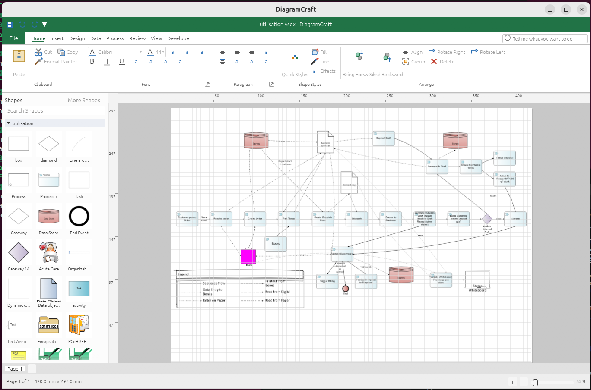

# DiagramCraft

[](LICENSE-MIT)
[](https://www.rust-lang.org/)
[](https://github.com/baradhili/DiagramCraft/actions/workflows/ci.yml)
[](https://z.ai)
[](https://z.ai)
[](https://github.com/morluto/rea)

A Linux/Windows/MacOS-native reimplementation of the Visio 2016 drawing experience in Rust: read and write `.vsdx`/`.vstx`/`.vssx` packages losslessly, render
them to SVG/PNG, edit them through an undoable command layer, and work in
a native desktop GUI with the Visio shell (ribbon, stencils, ShapeSheet).

Built clean-room: from recorded file-format and application-behavior
observations. No Microsoft code, content, or assets.

## Powered by

DiagramCraft is built in public using **[Z.ai GLM-5.x](https://z.ai)** for long-horizon agentic coding on a 1M-token context window, with deep binary-format reverse engineering supported by **[morluto/rea](https://github.com/morluto/rea)**.

The workload — multi-file refactors across a real binary format reverse-engineering effort — is exactly the long-running software-engineering task that GLM-5.x was designed for. The project would not be moving at this pace without Z.ai's Coding Plan. Hint Hint - sponsorship?..

If you're building a long-horizon coding project, [try GLM-5.x](https://z.ai) or [inquire about Z.ai open source sponsorships](https://z.ai/contact).

## Current screenshots



## Helping

Its sort of usable!

How can you help?

1. Create issues - it gives me and my agent a way to track what could be fixed

2. Close issues - there are plenty now and I only have so much token quota 

2. Create PR - awesome! - but please keep the PRs on a narrow feature (no 10000 line PRs please!) and make sure they are at least checked by CodeRabbit - or better Greptile

3. Spread the word!

## Workspace

- **`crates/vsdx`** — the VSDX-family format library: OPC package access,
  XML parsing into a typed document model, master/stylesheet inheritance
  (`F='Inh'`, row-cell and per-section inheritance), a ShapeSheet formula
  evaluator subset, and lossless writing (canonical-XML round-trip).
- **`crates/dc`** — the CLI: `render` (SVG backend with themes, gradients,
  Bézier/arc geometry, images, wrapped text, connector arrowheads),
  `info` / `inspect`, `roundtrip` (re-write + verify), and `edit`
  (undoable cell/text/shape edits).
- **`crates/dc-core`** — the editing core: `Command` trait, undo/redo
  history, scope addressing (`page:1/shape:5`), shape/page/layer/connect
  edits, stencil-master import, crash-safe saves.
- **`crates/dc-ui`** — the native desktop GUI (egui/eframe): Visio-2016
  shell with ribbon/QAT/status bar, canvas with rulers/grid/zoom, the
  Shapes pane (multiple open stencils, pane-wide search, Quick Shapes,
  and a built-in catalog of Visio-derived stencils), drag-to-page
  placement that imports stencil masters into the drawing, selection /
  resize / 1D-endpoint handles with live drag previews, double-click
  text editing, right-click context menus (including master Actions),
  ShapeSheet inspector, off-thread progressive rasterization, and
  headless kittest pixel/interaction tests.
- **`third_party/craft-ui`** — vendored egui widget library (see its
  README for provenance).

## Build & test

```sh
cargo build --workspace
cargo test --workspace
```

## Usage

```sh
# Inspect and render a drawing
cargo run -p dc -- info    path/to/file.vsdx
cargo run -p dc -- render  path/to/file.vsdx -o out.svg
cargo run -p dc -- render  path/to/file.vssx -o sheet.svg --masters

# Lossless round-trip with verification
cargo run -p dc -- roundtrip path/to/file.vsdx -o out.vsdx --verify

# Undoable edits through the command layer
cargo run -p dc -- edit path/to/file.vsdx -o out.vsdx \
    --cell page:0/shape:1 LineWeight 0.02 --text page:0/shape:1 "label"

# Native GUI
cargo run -p dc-ui -- path/to/file.vsdx
```

## GUI tests

Headless via egui_kittest (snapshots in `crates/dc-ui/tests/snapshots/`,
regenerate with `UPDATE_SNAPSHOTS=1`):

```sh
cargo test -p dc-ui --test shell
cargo test -p dc-ui --test interactions
```

## Installers

Release tags (`v*`) build installers through GitHub Actions
(`.github/workflows/release.yml`): a Windows NSIS installer (+ portable zip), a
universal macOS dmg, and Linux deb / rpm / AppImage packages. Push a tag
to cut a release:

```sh
git tag v0.2.5 && git push origin v0.2.5
```

Packaging metadata lives in the `dc-ui` manifest (`[package.metadata.deb]`,
`[package.metadata.generate-rpm]`), `packaging/installer.nsi` for the NSIS installer, and
`packaging/` for the desktop entry, icons, and macOS Info.plist.

## Commit conventions

Conventional Commits, enforced by [cargo-commitlint] through the tracked
`commit-msg` hook in `.githooks/` (rules in `commitlint.toml`). One-time
setup per clone:

```sh
cargo install cargo-commitlint --version 2.1.0 --locked
git config core.hooksPath .githooks
```

Bypass a single commit with `COMMITLINT_SKIP=1`.

## Roadmap

### M1–M5 — Current

M1–M4 (read VSDX, render to SVG, lossless write/round-trip, editing
core) shipped before the first public release. M5 — the GUI — shipped
as v0.1.0 and has deepened through the 0.2.x waves:

- **v0.1.1** — render-fidelity wave (text-block placement, HorzAlign
  mapping, ArcTo bulge direction, LinePattern 0 stroke suppression).
- **0.2.1** — ShapeSheet inspector for every shape (#76).
- **0.2.2** — render-path performance (#66): render-on-miss texture
  cache, parsed-tree reuse, off-thread rasterization, and per-shape
  canvas layers (moves re-render nothing, edits re-render only the
  touched shape); live drag previews (#96); AppImage glibc-2.39 floor
  fix (#100).
- **0.2.3** — Shapes pane wave (#63): multiple open stencils (#82),
  open `.vssx` through More Shapes / File→Open (#83), stencil masters
  imported into the drawing on first placement (#84), source-keyed
  thumbnail cache (#85), pane-wide search (#86), the built-in stencil
  catalog (#87), and Quick Shapes (#88).
- **0.2.4** — test-architecture wave (#97): de-duplicated and
  de-brittled suites across all four crates (#125).

Open GUI depth (not yet scheduled to a release): full-screen
presentation mode (#130), Change Shape (#131), freeform geometry
drawing (#132), native table shapes (#135), plus the standing
carry-forward — contextual ribbon tabs, snap/glue indicators,
connector routing UX, and the template flow.

### M6 — Ecosystem

- Data linking (`data` crate): CSV/SQLite recordsets → shape data
  (URS category "Data Linking"; spec'd in VeeTrace).
- Validation rules; automatic diagram layout (#134) and org-chart
  layout (`layout` crate — cleanroom analog of `@Visgrf` concepts).
- Export filters beyond SVG/PNG: PDF, interactive HTML (#127),
  PowerPoint (#128); competitor-format import — draw.io, Gliffy,
  Lucidchart (#126).
- Document version history and restore (#133); LaTeX math typesetting
  in shape text (#129). From the 2026-10-27 competitive review of
  ConceptDraw, draw.io, Lucidchart, SmartDraw, EdrawMax, OmniGraffle,
  Creately and ProcessOn (URS-1219…1228 in the VeeTrace pack).
- Legacy `.vsd` reader: OLE compound + `VisioDocument` stream reversal
  — needs deeper RE (the `CDMConvert*` inventory in VISLIB marks the
  migration seams to study).
- The "scripting/automation facade" formerly listed here has grown
  into M7/M8 below (owner direction 2026-10-16).

### M7 — VBA / `.vsdm` macro execution (planned)

- **`.vsdm` package support**: recognize/round-trip `.vsdm` losslessly
  (`vbaProject.bin` carried as a verbatim unmodeled part — the existing
  writer already preserves unknown parts; needs content-type/signature
  awareness and the macro-flag document settings).

- **VBA project reader**: OLE compound parse of `vbaProject.bin` + MS-OVBA decompression → macro inventory (module list, names) shown in a Developer-tab macro dialog.

- **VBA interpreter subset**: cleanroom execution of the practical macro subset (the same subset strategy as the ShapeSheet formula evaluator), driven against the M8 automation object model below.

- **Macro security model** (URS-194): enable/disable per document, trust prompts, `.vsdx` (macro-free) vs `.vsdm` save distinction.

### M8 — Real Visio add-in hosting (planned, spike-gated)

Goal: run real Visio add-ins, not reimplement them. First target:
`Sample/graphvisio` — GraphVizio, a 2014 x86 Windows MSI Visio add-in
for Graphviz layout (untracked sample, like all of `Sample/`).

- **Feasibility spike (gate)**: extract the MSI, identify the add-in binary type (COM DLL / VSL / .NET) and enumerate the Visio object model surface it touches (deep RE: REA + Ghidra on the extracted binary; add to the deep-RE queue).

- **Automation object model**: a cleanroom `Application`/`Document`/ `Page`/`Shape` facade over `dc-core` (the surface COM add-ins automate) — designed with M7 step 3 so macros and add-ins share it.

- **Host/loader**: whichever of (a) a Win32 COM emulation host that can load and service the real DLL on Linux, or (b) a Wine-side host with a bridge to the native core, the spike shows to be viable. If neither is viable, fall back to a compatibility plugin API (M9) plus per-addin reimplementation guides — decided at the gate, not before.

### M9 — Plugin system + diagram-language imports (nice-to-have)

  Plugins, not core (owner direction 2026-10-16). Rides on the M8
  automation facade or a lighter native plugin API if M8 lands after it.

- Plugin architecture: out-of-tree diagram sources, shape mappers, and command packs with a stable API over `dc-core`.

- Language import-renderers with **configurable shape mapping** (bind language node/edge types to masters/stencil shapes): **d2**, **Graphviz DOT** (synergy: GraphVizio is a Graphviz add-in — 
  
  its public behavior is a useful oracle), and **Mermaid**.

## License

MIT OR Apache-2.0 (see `LICENSE-MIT` / `LICENSE-APACHE`). GUI icons are
the vendored Pictogrammers Material Design Icons set (Apache-2.0), in
`crates/dc-ui/assets/icons/` with their license and provenance notes.

[cargo-commitlint]: https://crates.io/crates/cargo-commitlint
